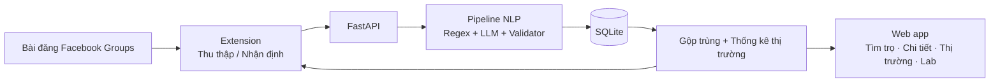

# ReNER-VN

**Đọc đúng giá thuê trọ từ bài đăng Facebook, rồi biết giá đó cao hay thấp so với các tin tương tự.**

**Web demo:** [TrọCheck — trocheck.vercel.app](https://trocheck.vercel.app/)

Đồ án môn TMG301 — Xử lý ngôn ngữ tự nhiên, đề tài 8: *Trích xuất thông tin bất động sản từ bài đăng mạng xã hội (Real Estate NER)*. Repo này là nơi nhóm xây sản phẩm thật: web app, bộ xử lý dữ liệu và extension Chrome.

> **Trạng thái:** web Next.js đủ khu công khai, tài khoản (kể cả đăng nhập Google), khu người thuê và khu nhóm; API FastAPI + SQLite + worker/pipeline; bản demo chạy trên Vercel (web) và Render (API). Extension Chrome chưa có. Xem [hướng dẫn web](apps/web/README.md) và [API](apps/api/README.md).


---

## Sản phẩm làm gì?

Một bài cho thuê trên Facebook thường trông như thế này (ví dụ tự tạo):

> Cho thuê CCMN 1PN 30m2 ngay gần ĐH FPT, full nội thất. Giá 5tr5/th, điện 3k5/số, nước 100k/người, cọc 1 tháng. LH 09xx xxx xxx

Người đi thuê phải tự hiểu: giá thuê là **5.500.000 đ/tháng**; "3k5/số", "100k/người", "cọc 1 tháng" là **phí**, không phải giá. Sau đó họ vẫn không biết 5,5 triệu là đắt hay rẻ ở khu đó.

ReNER-VN giải quyết hai việc:

1. **Trích xuất:** đọc bài, điền bảng chuẩn gồm Giá, Diện tích, Vị trí, Số phòng và các khoản phí. Mỗi giá trị trỏ về đúng đoạn chữ trong bài. Không có thông tin thì để trống, không đoán.
2. **Nhận định giá:** so giá của tin với **trung vị** các tin tương tự đã thu (cùng phường, cùng loại, cùng khoảng diện tích). Có ít hơn 10 tin để so thì báo "chưa đủ dữ liệu", không đưa ra con số.

## Ba thành phần

| Thành phần | Ai dùng | Làm gì | Tài liệu |
|---|---|---|---|
| **Extension Chrome** | Nhóm thu dữ liệu; người đi thuê | *Thu thập*: đọc các bài khi lướt nhóm, gửi về kho. *Nhận định*: chọn một bài, xem ngay kết quả | [Đặc tả extension](docs/03-system/05-extension.md) |
| **Web app** | Người đi thuê; nhóm làm đồ án | Tìm và lọc tin, xem chi tiết có bằng chứng, xem thị trường. Khu "Lab" cho thấy quá trình NLP: bôi màu nhãn, so Regex/LLM/nhãn chuẩn, chỉ số đánh giá | [Tính năng và màn hình](docs/01-product/03-tinh-nang-va-man-hinh.md) |
| **Bộ xử lý dữ liệu** | Chạy trong backend | Tiền xử lý → phân loại bài → Regex + LLM có neo nguồn → chuẩn hóa → đối chiếu → gộp trùng → thống kê | [Pipeline](docs/02-data/03-pipeline-xu-ly.md) |



## Chạy demo local trên Windows

Cần Python >= 3.11, Node.js >= 20. Từ repo root (đường dẫn có dấu cách dùng được):

```powershell
python scripts/init-local-env.py
# Nếu python mặc định quá cũ, đặt $env:RENER_PYTHON tới python.exe >= 3.11.
.\scripts\dev.ps1 setup
.\scripts\dev.ps1 seed
.\scripts\dev.ps1 dev
```

Mở http://localhost:3000 và http://127.0.0.1:8000/docs. Có thể chạy `api`, `worker`, `web` trong ba terminal thay `dev`. Script tạo env không ghi đè file đang có, không in mật khẩu; API đọc `.env` root, web đọc `apps/web/.env.local`. DB SQLite phát triển dùng đường dẫn tuyệt đối. `SEED_PASSWORD` được CLI đọc từ `.env` hoặc môi trường; không cần truyền mật khẩu trên command line. Thiếu Gemini key/model thì worker chạy **Regex-only**.

`DEMO_MODE=true` xem bộ tự tạo có nhãn; `/tim-tro?demo=false` xem kho thật. Không trộn hai bộ. Kho thật rỗng thì web báo rỗng. Các trang đọc API thật, không fallback mock; trang chủ giữ ví dụ minh họa khi kho rỗng/lỗi. Cấu hình, sinh type và kiểm thử: [README web](apps/web/README.md).

## Đọc theo thứ tự nào?

| Bạn là | Đọc |
|---|---|
| Thành viên mới | README này → [tầm nhìn và người dùng](docs/01-product/01-tam-nhin-va-nguoi-dung.md) → [lộ trình và phân công](docs/05-delivery/01-lo-trinh-va-phan-cong.md) |
| Làm frontend (TV3) | [Hành trình](docs/01-product/02-hanh-trinh-nguoi-dung.md) → [màn hình](docs/01-product/03-tinh-nang-va-man-hinh.md) → [API](docs/03-system/03-api-contract.md) → [apps/web](apps/web/README.md) |
| Làm backend/LLM (TV2) | [Kiến trúc](docs/03-system/01-kien-truc.md) → [luồng web](docs/03-system/02-luong-web.md) → [API](docs/03-system/03-api-contract.md) → [CSDL](docs/03-system/04-co-so-du-lieu.md) → [apps/api](apps/api/README.md) |
| Làm NLP/đánh giá (TV1) | [Từ điển dữ liệu](docs/02-data/01-tu-dien-du-lieu.md) → [gán nhãn](docs/02-data/02-huong-dan-gan-nhan.md) → [chuẩn hóa](docs/02-data/04-quy-tac-chuan-hoa.md) → [đánh giá](docs/04-evaluation/01-ke-hoach-danh-gia.md) |
| Làm extension/dữ liệu (TV4) hoặc bên nhận làm extension | [Đặc tả extension](docs/03-system/05-extension.md) → [schema gửi bài](spec/schemas/ingest-post.schema.json) |
| Giảng viên / người chấm | [Proposal và đối chiếu](docs/00-proposal/README.md) → [kế hoạch đánh giá](docs/04-evaluation/01-ke-hoach-danh-gia.md) → [kịch bản demo](docs/05-delivery/02-demo-va-nghiem-thu.md) |

Toàn bộ mục lục: [docs/README.md](docs/README.md).

## Cấu trúc repo

```text
docs/
  00-proposal/        Proposal v1.3 đã nộp + đối chiếu với repo
  01-product/         Người dùng, hành trình, tính năng, màn hình
  02-data/            Từ điển dữ liệu, gán nhãn, pipeline, chuẩn hóa, gộp trùng, thống kê
  03-system/          Kiến trúc, luồng web, API, CSDL, extension
  04-evaluation/      Tập dữ liệu, chia tập, chỉ số, RQ1–RQ4
  05-delivery/        Lộ trình, phân công, demo, nghiệm thu, rủi ro
  decisions/          Quyết định kiến trúc (ADR)
spec/
  schemas/            JSON Schema: dữ liệu extension gửi lên, kết quả trích xuất
  fixtures/           Bài mẫu tự tạo kèm kết quả mong đợi
apps/
  web/                Next.js — B1 nối API cho 3 trang công khai
  api/                FastAPI + pipeline + worker + tests
  extension/          Chrome MV3 — chưa code, giao bên làm extension
data/                 Quy ước lưu dữ liệu (dữ liệu thật không commit)
eval/                 Script đánh giá; không chạy test split trong B1
```

## Công nghệ

Next.js (web) · FastAPI (API + pipeline Python) · SQLite (kho dữ liệu demo) · Gemini API (LLM) · Chrome Extension Manifest V3. Lý do và điều kiện đổi: [ADR-0001](docs/decisions/ADR-0001-stack-demo.md).

## Nhóm

| Vai trò | Phụ trách | Thành viên |
|---|---|---|
| TV1 | NLP Lead — regex, chuẩn hóa, đánh giá | *[điền]* |
| TV2 | LLM & Backend Lead | *[điền]* |
| TV3 | Frontend / UI Lead | *[điền]* |
| TV4 | Extension & Data Lead | *[điền]* |

Cách làm việc chung: [CONTRIBUTING.md](CONTRIBUTING.md). Quy tắc dữ liệu: [docs/02-data](docs/02-data/), API và kiến trúc: [docs/03-system](docs/03-system/).

## Nguyên tắc dữ liệu

Chỉ thu bài trong nhóm Facebook mà người dùng là thành viên, quy mô nhỏ, dừng khi Facebook yêu cầu xác minh. Số điện thoại bị che ngay trên máy người dùng trước khi gửi đi. Không lưu tên người đăng. Dữ liệu chỉ dùng nội bộ cho đồ án, **không commit dữ liệu thật lên repo**.
