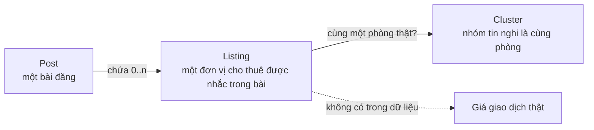

# Từ điển dữ liệu

File này là **nguồn duy nhất** cho tên khái niệm, tên trường và giá trị enum. Code, nhãn, API và giao diện dùng đúng các tên dưới đây. Đổi tên phải đổi ở đây trước, kèm một ADR. Bản máy đọc được: [spec/schemas/listing-extraction.schema.json](../../spec/schemas/listing-extraction.schema.json).

## 1. Bốn đối tượng không được đánh đồng



| Đối tượng | Nghĩa | Ví dụ |
|---|---|---|
| **Post** | Một bài đăng thu được tại một thời điểm | Bài "Cho thuê 2 phòng: P1 20m2 2tr8, P2 30m2 3tr5" |
| **Listing** | Một đơn vị cho thuê trong bài. Một bài có thể có nhiều listing | P1 và P2 là hai listing |
| **Cluster** | Các listing được cho là cùng một phòng (môi giới đăng lại, đăng nhiều nhóm) | Cùng phòng P1 xuất hiện ở 3 nhóm → 1 cluster |
| **Giá giao dịch** | Giá thuê thật khi ký hợp đồng | Hệ thống **không có** dữ liệu này |

Thống kê thị trường đếm theo **cluster**, không đếm theo post.

## 2. Thuật ngữ

| Thuật ngữ | Tên trong code | Nghĩa trong dự án | Không phải |
|---|---|---|---|
| Giá thuê | `rent` | Số tiền thuê định kỳ chủ trọ chào | Tiền cọc, tiền điện/nước, giá trung bình |
| Giá chào thuê | `asking_rent` | Giá ghi trong bài | Giá giao dịch |
| Phí | `fees` | Khoản tiền ngoài tiền thuê: cọc, điện, nước, dịch vụ, internet, gửi xe | Giá thuê |
| Đơn vị tính giá | `basis` | Giá cho cả phòng/căn hay cho mỗi người | Đơn vị tiền tệ |
| Chu kỳ | `period` | Tháng, ngày | — |
| Mốc vị trí | `landmark` | "gần ĐH FPT", "đối diện chợ X" | Địa chỉ chính xác |
| Phường chuẩn | `ward_code`, `ward_name` | Phường theo hệ hành chính 2 cấp (từ 01/07/2025) | Quận/huyện (đã bỏ) |
| Bằng chứng | `evidence` | Vị trí đoạn chữ trong bài sinh ra giá trị | Lời giải thích của LLM |
| Tập chuẩn | `gold` | Bài gán nhãn tay dùng để đánh giá | Kho thị trường |
| Kho thị trường | `market` | Bài tự trích xuất dùng để thống kê | Tập chuẩn |

## 3. Post

| Trường | Kiểu | Bắt buộc | Mô tả |
|---|---|---|---|
| `id` | string (ULID) | ✓ | Mã nội bộ |
| `source_type` | enum `facebook_group` \| `manual_paste` \| `import_file` \| `fixture` | ✓ | Nguồn bài |
| `source_group_id` | string | | Mã nhóm Facebook (nếu có) |
| `source_group_name` | string | | Tên nhóm, chỉ để hiển thị nội bộ |
| `permalink` | string (URL) | | Link bài gốc |
| `external_post_id` | string | | Mã bài lấy từ link, dùng gộp trùng mức bài |
| `posted_at` | datetime UTC | | Thời gian đăng nếu đọc được |
| `collected_at` | datetime UTC | ✓ | Thời gian thu |
| `collector_id` | string | ✓ | Tài khoản thu |
| `mode` | enum `collect` \| `assess` | ✓ | Đến từ chế độ nào của extension |
| `text` | string | ✓ | Nội dung **đã che số điện thoại**. Không lưu bản chưa che |
| `text_hash` | string (sha256 của text đã chuẩn hóa) | ✓ | Gộp trùng mức nội dung |
| `contributed` | bool | ✓ | `true` với bài thu ở chế độ collect; với assess chỉ `true` khi người dùng bấm Đóng góp |
| `post_type` | enum, xem §6 | | Kết quả phân loại bài |
| `status` | enum, xem §6 | ✓ | Trạng thái xử lý |
| `is_demo` | bool | ✓ | Dữ liệu tự tạo để demo, không được tính vào thống kê thật hay đánh giá |

**Không lưu:** tên người đăng, ảnh đại diện, bình luận, số điện thoại, HTML thô của trang.

## 4. Listing

Mỗi listing gồm năm nhóm trường. Mỗi trường có thêm `evidence[]` và `decision` (§5).

### 4.1 `rent` — giá thuê

| Trường | Kiểu | Giá trị |
|---|---|---|
| `visibility` | enum | `disclosed` có ghi số · `hidden_explicit` ghi rõ "ib giá", "inbox", "liên hệ để biết giá" · `not_stated` không nhắc tới giá · `ambiguous` chính bài viết mơ hồ, đọc kỹ vẫn không xác định được |
| `amount_form` | enum | `exact` một số · `range` khoảng "3–3,5tr" · `starting_from` "từ 3tr" · `none` |
| `amount_vnd` | int | Chỉ khi `exact` |
| `min_vnd`, `max_vnd` | int | Khi `range` (`max_vnd` rỗng nếu `starting_from`) |
| `basis` | enum | `per_unit` cả phòng/căn · `per_person` mỗi người · `unknown` |
| `period` | enum | `month` · `day` · `unknown` |
| `includes` | list enum fee type | Khoản đã bao trong giá, ví dụ `["electricity","water"]` khi bài ghi "bao điện nước" |

Quy tắc: `basis` chỉ là `per_unit` khi bài nói rõ (`/phòng`, `/căn`, `cả phòng`) **hoặc** luật ngữ cảnh trong [quy tắc chuẩn hóa](04-quy-tac-chuan-hoa.md) cho phép. Không đủ căn cứ thì `unknown`. `5tr5/th` một mình cho biết số và chu kỳ, chưa cho biết basis.

### 4.2 `area` — diện tích

| Trường | Kiểu | Giá trị |
|---|---|---|
| `amount_form` | enum | `exact` · `range` · `none` |
| `value_m2` | number | Khi `exact` |
| `min_m2`, `max_m2` | number | Khi `range` |
| `from_dimensions` | bool | `true` nếu tính từ kích thước "4x8" |

### 4.3 `room` — loại hình và số phòng

| Trường | Kiểu | Giá trị |
|---|---|---|
| `property_type` | enum | `phong_tro` · `ccmn` (chung cư mini) · `can_ho_dich_vu` · `nha_nguyen_can` · `unknown` |
| `bedrooms` | int | Số phòng ngủ ("1PN" → 1; "studio" → 0) |
| `bathrooms` | int | Số WC nếu ghi |
| `mezzanine` | bool | Có gác lửng |
| `private_bathroom` | bool | Khép kín / WC riêng |
| `furnishing` | enum | `full` · `basic` · `none` · `unknown` (chỉ dùng hiển thị, không dùng nhóm so sánh ở bản demo) |

### 4.4 `location` — vị trí

| Trường | Kiểu | Giá trị |
|---|---|---|
| `landmark` | string | Mốc nguyên văn: "gần ĐH FPT" |
| `street` | string | Tên đường nếu có |
| `ward_code`, `ward_name` | string | Phường chuẩn hệ mới; rỗng nếu không xác định chắc chắn |
| `old_ward_name`, `old_district_name` | string | Tên cũ ghi trong bài, giữ lại để tra |
| `resolution` | enum | `exact` ghi rõ phường · `from_street` suy từ tên đường có trong từ điển · `from_landmark` suy từ mốc có trong từ điển · `unresolved` |

### 4.5 `fees[]` — các khoản phí

| Trường | Kiểu | Giá trị |
|---|---|---|
| `type` | enum | `deposit` cọc · `electricity` điện · `water` nước · `service` dịch vụ/vệ sinh · `internet` · `parking` gửi xe · `other` |
| `amount_vnd` | int | Số tiền nếu có |
| `unit` | enum | `per_kwh` · `per_m3` · `per_person_month` · `per_unit_month` · `months_of_rent` · `one_time` · `unknown` |
| `months` | number | Khi `unit = months_of_rent` ("cọc 1 tháng" → 1) |
| `free` | bool | "free nước", "miễn phí wifi" |
| `state_rate` | bool | "điện giá nhà nước" (không có số) |

## 5. Bằng chứng và quyết định cho mỗi trường

| Trường | Kiểu | Giá trị |
|---|---|---|
| `evidence[]` | list | Mỗi phần tử: `start`, `end` (vị trí ký tự Unicode trên `text`), `quote` (đúng bằng `text[start:end]`), `label` (PRICE/AREA/LOC/ROOM/FEE), `method` (`regex` · `llm` · `human`), `rule_id` (với regex) |
| `decision` | enum | `answered` có giá trị · `abstained` để trống có lý do · `needs_review` cần người xem |
| `abstain_reason` | enum | `not_in_text` · `ambiguous_source` · `conflict` · `llm_error` · `unsupported_format` |
| `agreement` | enum | `both_agree` Regex và LLM ra cùng giá trị chuẩn · `regex_only` · `llm_only` · `conflict` hai bên khác nhau · `human` người duyệt đặt |

`agreement` là **trạng thái quy trình**, không phải xác suất đúng. Giao diện không hiển thị nó thành phần trăm.

## 6. Enum trạng thái

| Enum | Giá trị | Ai đổi |
|---|---|---|
| `post_type` | `rental_offer` cho thuê · `seeking` cần thuê · `roommate` tìm người ở ghép · `sale` mua bán · `spam` · `other` | Pipeline (M2), người duyệt sửa |
| `post.status` | `received` → `processing` → `extracted` / `rejected_type` / `failed` | Pipeline |
| `listing.review_status` | `auto_accepted` · `needs_review` · `approved` · `rejected` · `duplicate` | Pipeline đặt ban đầu, người duyệt đổi |
| `job.status` | `queued` → `running` → `succeeded` / `failed`; lỗi tạm thời: `running` → `queued` (tăng `attempt`) | Worker |

Ba vòng đời tách nhau: **job `succeeded`** nghĩa là chạy xong, chưa có nghĩa listing đã được duyệt hay đủ điều kiện thống kê.

## 7. Ví dụ một listing hoàn chỉnh

Bài (tự tạo): `Cho thuê CCMN 1PN 30m2 ngay gần ĐH FPT, full nội thất. Giá 5tr5/th/phòng, điện 3k5/số, nước 100k/người, cọc 1 tháng.`

```json
{
  "listing_index": 0,
  "rent": {
    "visibility": "disclosed", "amount_form": "exact", "amount_vnd": 5500000,
    "basis": "per_unit", "period": "month", "includes": [],
    "decision": "answered", "agreement": "both_agree",
    "evidence": [{"start": 62, "end": 74, "quote": "5tr5/th/phòng", "label": "PRICE", "method": "regex", "rule_id": "PRICE_TR_SUFFIX"}]
  },
  "area": {"amount_form": "exact", "value_m2": 30, "from_dimensions": false, "decision": "answered"},
  "room": {"property_type": "ccmn", "bedrooms": 1, "mezzanine": false, "furnishing": "full", "decision": "answered"},
  "location": {"landmark": "gần ĐH FPT", "ward_code": null, "resolution": "unresolved", "decision": "answered"},
  "fees": [
    {"type": "electricity", "amount_vnd": 3500, "unit": "per_kwh"},
    {"type": "water", "amount_vnd": 100000, "unit": "per_person_month"},
    {"type": "deposit", "unit": "months_of_rent", "months": 1}
  ],
  "review_status": "auto_accepted"
}
```

Vị trí `start`/`end` trong ví dụ mang tính minh họa; bản chính xác nằm trong [spec/fixtures](../../spec/fixtures/README.md), nơi chúng được kiểm bằng máy. Vị trí mốc "gần ĐH FPT" chưa map được phường nếu từ điển mốc chưa có, nên `resolution = unresolved`.
