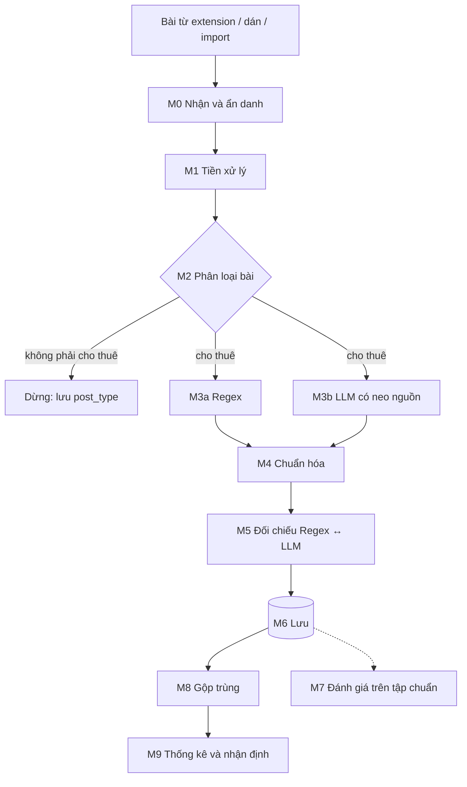

# Pipeline xử lý dữ liệu

Từ chữ của một bài đăng tới bản ghi chuẩn hóa và nhận định giá. Mã module M0–M9 theo Hình 1 của proposal. Code đặt trong `apps/api/app/pipeline/`.

Mọi bước ghi phiên bản (`pipeline_version`, `regex_version`, `prompt_version`, `model_id`, `normalizer_version`) vào lần chạy để kết quả tái lập được.

---

## M0 — Nhận và ẩn danh

- **Vào:** payload từ extension theo [ingest-post.schema.json](../../spec/schemas/ingest-post.schema.json).
- **Làm:** kiểm schema; kiểm lại số điện thoại đã che (extension che trước, server che lần nữa cho chắc); bỏ tên người đăng nếu lỡ có; tính `text_hash`; gộp trùng mức bài (cùng `external_post_id` hoặc cùng `text_hash` trong cùng nhóm → không tạo post mới, chỉ cập nhật `last_seen_at`).
- **Ra:** `post` với `status = received`, một `job` `queued`.
- **Lỗi:** payload sai schema → 422 trả về extension, không lưu.

Mẫu che số điện thoại: chuỗi 9–11 chữ số có thể chứa dấu cách/chấm/gạch, bắt đầu bằng `0` hoặc `+84`, kể cả dạng viết tách `09xx xxx xxx`. Thay bằng `[SĐT]`.

## M1 — Tiền xử lý

- **Chuẩn hóa Unicode** về NFC (tiếng Việt có hai cách mã hóa dấu).
- **Giữ bản đồ vị trí ký tự**: mọi phép biến đổi (gộp khoảng trắng, đổi ký tự) phải ánh xạ được về vị trí trên `post.text` để bôi màu đúng chỗ. Cách đơn giản nhất: **không sửa `post.text`**, chỉ tạo bản `norm_text` kèm mảng ánh xạ `norm_index → text_index`.
- **Từ điển viết tắt** (`apps/api/app/pipeline/lexicon/`): `tr`, `triệu`, `củ` → triệu; `k`, `nghìn`, `ngàn` → nghìn; `PN` → phòng ngủ; `WC`, `VS` → vệ sinh; `CCMN`; `DT`, `dt` → diện tích; `th`, `tháng`; `ng`, `người`. Từ điển là dữ liệu, có version.
- **Tách token** cố định, dùng chung cho Regex, gán nhãn và đánh giá.

## M2 — Phân loại bài

- **Nhãn:** `rental_offer` · `seeking` · `roommate` · `sale` · `spam` · `other`.
- **Cách làm (theo thứ tự đơn giản → phức tạp):** luật từ khóa ("cần tìm", "cần thuê", "tìm người ở ghép", "bán", "sang nhượng") → nếu không chắc thì để LLM phân loại trong cùng lời gọi ở M3b. Phương án học máy nhẹ (TF-IDF + Logistic Regression, kiến thức môn TMG301) là P1, chỉ khi có đủ bài gán nhãn loại.
- **Ra:** `post_type`. Không phải `rental_offer` → dừng, `post.status = rejected_type`.

## M3a — Regex (baseline)

- Mỗi luật có **mã định danh** (`rule_id`), mẫu, nhãn, ví dụ đúng, ví dụ không được bắt. Luật để trong file dữ liệu có version, không rải trong code.
- **Luật giá** bắt `5tr5`, `5.5tr`, `5,5 triệu`, `5 triệu 5`, `5tr`, `1tr5/người`, khoảng `3-3,5tr`, `từ 3tr`.
- **Luật loại trừ theo ngữ cảnh** để không nhầm phí thành giá: số đứng sau `cọc`, `điện`, `nước`, `dịch vụ`, `phí`, `wifi`, `gửi xe` trong cửa sổ vài token → FEE, không phải PRICE.
- **Luật diện tích, phòng, vị trí**: `30m2`, `4x8`; `1PN`, `2PN1WC`, `studio`, `gác lửng`, `khép kín`; `gần <mốc>`, `đường/ngõ/hẻm <tên>`, `P./phường <tên>`.
- **Ra:** danh sách span (start, end, label, rule_id) + giá trị thô.

## M3b — LLM có neo nguồn

- **Mô hình:** Gemini qua API (bậc miễn phí), `model_id` ghi cố định khi đóng băng hệ thống.
- **Đầu vào:** chữ của bài, vài ví dụ mẫu (lấy từ tập phát triển, **không bao giờ** từ tập test), lược đồ JSON phẳng.
- **Yêu cầu đầu ra:** với mỗi giá trị, trả **đoạn trích nguyên văn** (`quote`) và nhãn; không trả số đã quy đổi. Có trường `listing_index` cho bài nhiều phòng và `post_type`.
- **Kiểm sau khi nhận:**
  1. JSON đúng lược đồ, sai thì thử lại tối đa theo cấu hình rồi đánh dấu `llm_error`.
  2. `quote` phải xuất hiện trong bài; tìm được vị trí `start/end`. Không tìm thấy → **loại giá trị đó** (chống bịa). Quote xuất hiện nhiều lần → chọn lần gần các span cùng listing, ghi chú lại.
- **Chi phí:** chỉ gọi LLM khi cần (xem M5) ở chế độ chạy thật; ở chế độ đánh giá thì chạy trên mọi bài để so sánh công bằng. Cache theo `text_hash + prompt_version + model_id`.
- **Lỗi mạng / hết hạn mức (429):** thử lại có giãn cách, tôn trọng thời gian chờ provider báo; hết số lần thì giữ kết quả Regex, ghi `llm_error`, `decision = needs_review` cho các trường thiếu.

## M4 — Chuẩn hóa

Biến đoạn chữ thành giá trị theo [từ điển dữ liệu](01-tu-dien-du-lieu.md). **Code tất định** làm việc này cho cả kết quả Regex lẫn LLM, nên hai phương pháp chỉ khác ở bước tìm span. Quy tắc chi tiết: [quy tắc chuẩn hóa](04-quy-tac-chuan-hoa.md).

## M5 — Đối chiếu

| Regex | LLM | `agreement` | Xử lý |
|---|---|---|---|
| Có giá trị A | Có giá trị A (sau chuẩn hóa) | `both_agree` | Nhận A |
| Có A | Không có | `regex_only` | Nhận A; nếu là trường giá thì `needs_review` khi bài có nhiều số tiền |
| Không có | Có B, quote hợp lệ | `llm_only` | Nhận B, `needs_review` với trường giá |
| Có A | Có B ≠ A | `conflict` | Giữ cả hai trong evidence, `needs_review`, không lấy trung bình |
| Không có | Không có | — | `abstained`, lý do theo `visibility` |

**Chế độ tiết kiệm (chạy thật):** Regex chạy trước. Gọi LLM khi: thiếu giá hoặc diện tích; có từ 3 số tiền trở lên; có dấu hiệu nhiều phòng; Regex bắt được giá nhưng không xác định `basis`. Không gọi LLM thì ghi `llm_status = not_run` (không giả là hai bên đồng thuận).

**`review_status` ban đầu của listing:** `auto_accepted` khi các trường giá, vị trí là `both_agree` hoặc `regex_only` không có cờ, và không phải bài nhiều phòng; còn lại `needs_review`.

## M6 — Lưu

Ghi post, listing, các trường, evidence, run vào SQLite theo [cơ sở dữ liệu](../03-system/04-co-so-du-lieu.md). Kết quả xử lý lại tạo **lần chạy mới**, không ghi đè lịch sử.

## M7 — Đánh giá

Chạy định kỳ trên tập chuẩn, không chạy trên kho thị trường. Xem [kế hoạch đánh giá](../04-evaluation/01-ke-hoach-danh-gia.md).

## M8 — Gộp trùng

Hai mức: cùng bài (đã xử lý ở M0) và cùng phòng. Chi tiết: [gộp trùng và thống kê](05-gop-trung-va-thong-ke.md).

## M9 — Thống kê và nhận định

Trung vị, P25–P75, giá/m² theo nhóm tương tự; N < 10 thì không kết luận. Chi tiết: [gộp trùng và thống kê](05-gop-trung-va-thong-ke.md).

---

## Bảng tóm tắt đầu vào/đầu ra

| Module | Vào | Ra | Người phụ trách |
|---|---|---|---|
| M0 | payload extension | post, job | TV2 |
| M1 | post.text | norm_text, token, bản đồ vị trí | TV1 |
| M2 | norm_text | post_type | TV1 (luật), TV2 (LLM) |
| M3a | norm_text | span Regex | TV1 |
| M3b | text | span LLM + listing_index | TV2 |
| M4 | span | giá trị chuẩn | TV1 |
| M5 | giá trị hai phía | giá trị chọn, agreement, review_status | TV1, TV2 |
| M6 | tất cả | bản ghi DB | TV2 |
| M7 | tập chuẩn + run | chỉ số | TV1, TV4 |
| M8 | listing | cluster | TV1, TV2 |
| M9 | cluster đủ điều kiện | thống kê, nhận định | TV1, TV2 |
