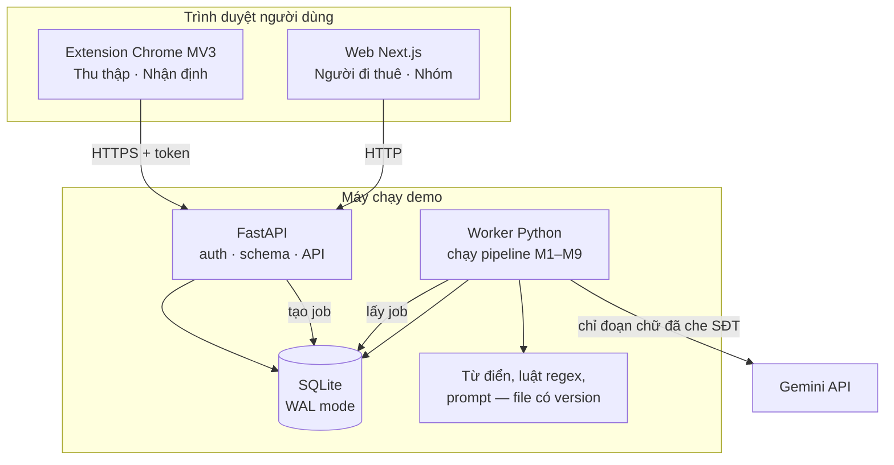

# Kiến trúc hệ thống

## 1. Toàn cảnh



| Thành phần | Trách nhiệm | Không làm |
|---|---|---|
| Extension | Lấy chữ bài đăng, che SĐT, gửi API, hiện panel kết quả | Không trích xuất, không tính thống kê, không giữ khóa LLM |
| Web | Hiển thị, lọc, form duyệt; gọi API | Không tự tính trung vị, không đọc DB trực tiếp |
| API | Xác thực, kiểm dữ liệu vào, đọc/ghi DB, tạo job, trả kết quả | Không gọi LLM trong request (để không bắt người dùng chờ) |
| Worker | Chạy pipeline, gọi LLM, ghi kết quả, cập nhật thống kê | Không phục vụ HTTP |
| SQLite | Lưu mọi thứ, kể cả hàng đợi job | — |

## 2. Vì sao chọn như vậy

- **Theo proposal:** Chrome Extension, FastAPI, SQLite, Next.js, Gemini (proposal mục 4). Quyết định và điều kiện đổi: [ADR-0001](../decisions/ADR-0001-stack-demo.md).
- **Một backend, một worker:** pipeline NLP viết bằng Python, dùng chung cho API, worker và script đánh giá. Đánh giá và sản phẩm chạy **cùng một code trích xuất**, nên số liệu trong báo cáo đúng với cái người dùng thấy.
- **Job qua DB:** gọi LLM mất vài giây và có thể lỗi; API trả mã job ngay, worker xử lý sau. Quy mô demo (vài trăm bài, vài người dùng) không cần Redis hay hàng đợi riêng.
- **SQLite chế độ WAL:** cho phép đọc trong lúc worker ghi. Khi có nhiều người ghi đồng thời (pilot thật) thì chuyển PostgreSQL; lớp truy cập dữ liệu viết qua ORM để chuyển ít đau.

## 3. Cấu trúc thư mục code (dự kiến)

```text
apps/
  api/
    app/
      main.py                  # tạo FastAPI app, gắn router
      api/                     # router theo nhóm: ingest, analyses, listings, market, team, lab, eval
      core/                    # cấu hình, auth, kết nối DB, lỗi chuẩn
      models/                  # ORM: post, listing, field, evidence, cluster, job, run, user
      schemas/                 # Pydantic: request/response, sinh từ spec/schemas
      pipeline/
        preprocess.py          # M1
        classify.py            # M2
        regex_extractor.py     # M3a
        llm_extractor.py       # M3b
        normalize.py           # M4
        reconcile.py           # M5
        dedup.py               # M8
        market.py              # M9
        lexicon/               # từ điển viết tắt, luật regex, địa bàn (YAML, có version)
        prompts/               # prompt LLM có version
      worker/run.py            # vòng lặp lấy job
    tests/                     # test theo từng module + fixture từ spec/fixtures
    migrations/
  web/
    src/app/                   # route Next.js theo sơ đồ trang
    src/features/              # listings, analysis, market, review, lab, eval
    src/components/            # UI dùng chung: thẻ tin, bảng phí, thanh phân bố, bôi màu nhãn
    src/lib/api/               # client sinh từ OpenAPI của FastAPI, không sửa tay
  extension/                   # giao bên làm extension, xem 05-extension.md
eval/
  run_eval.py                  # chạy Regex/LLM/Hybrid trên tập chuẩn, xuất chỉ số
  runs/                        # kết quả mỗi lần chạy (manifest + metrics), commit được
data/                          # không commit dữ liệu thật
spec/                          # schema + fixture dùng chung
```

## 4. Quy tắc phụ thuộc

```text
web/extension  →  API (HTTP, theo OpenAPI)  →  router  →  service / pipeline  →  models (DB)
```

- Router chỉ kiểm dữ liệu vào, gọi service, trả DTO. Không viết nghiệp vụ trong router.
- Hàm chuẩn hóa (M4) và đối chiếu (M5) là **hàm thuần**: không gọi mạng, không đọc DB. Dễ test bằng bảng [quy tắc chuẩn hóa](../02-data/04-quy-tac-chuan-hoa.md).
- Chỉ `llm_extractor.py` được gọi Gemini; khóa API chỉ có ở worker (biến môi trường), không bao giờ ở web hay extension.
- Web và extension dùng client sinh từ OpenAPI; đổi API thì sinh lại client, không tự đoán tên trường.

## 5. Cách chạy local (khi đã có code)

```text
make setup     # cài phụ thuộc Python + Node, tạo DB, chạy migration
make seed      # nạp bài mẫu có nhãn DEMO từ spec/fixtures
make dev       # chạy API (cổng 8000) + worker + web (cổng 3000)
make test      # test pipeline + API
make eval      # chạy đánh giá trên tập phát triển
```

Lệnh trên là quy ước để nhóm thực hiện; chưa tồn tại. Biến môi trường mẫu: [.env.example](../../.env.example).

## 6. Hướng mở rộng (không làm trong đồ án)

| Khi | Đổi |
|---|---|
| Nhiều người dùng ghi đồng thời, cần chạy 24/7 | SQLite → PostgreSQL; chạy trên VPS; thêm reverse proxy + HTTPS |
| Job chờ lâu vì nhiều bài | Thêm worker; dùng thư viện hàng đợi cho PostgreSQL |
| Có đủ dữ liệu gán nhãn | Thêm mô hình CRF/PhoBERT làm phương pháp thứ tư |
