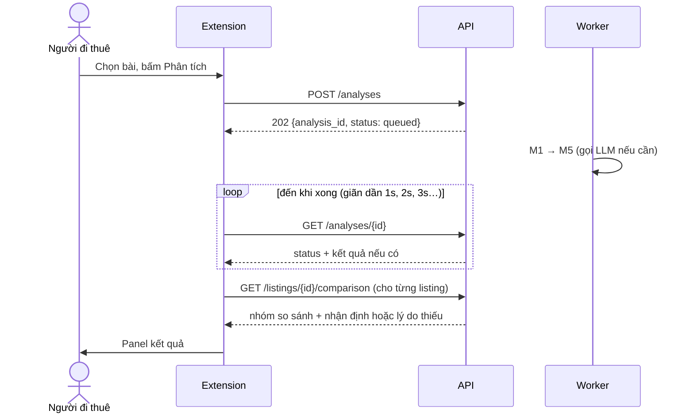
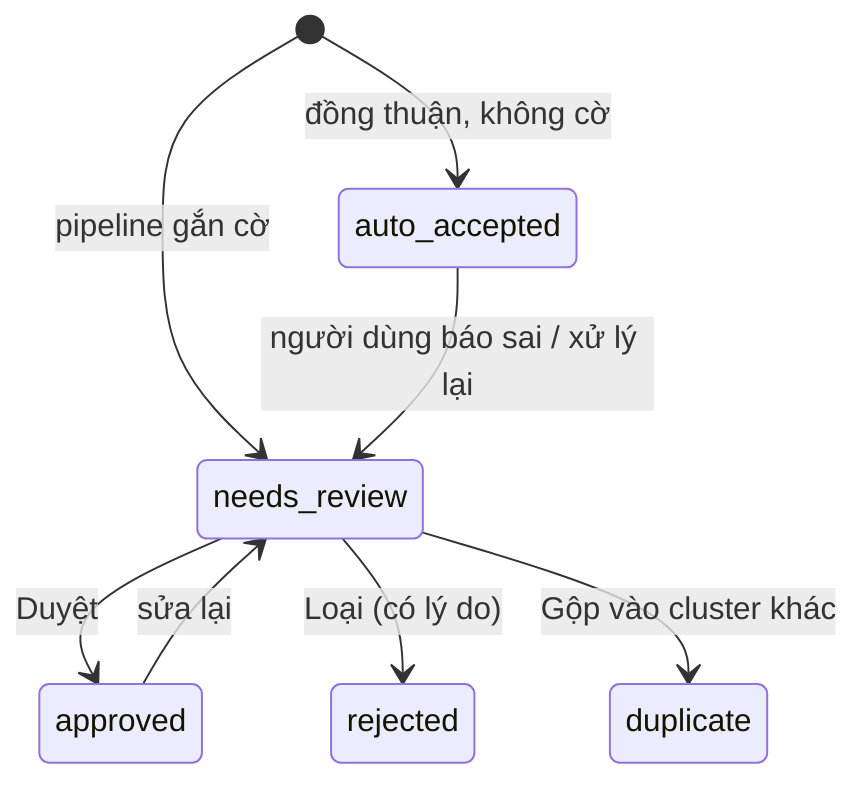

# Luồng xử lý của web

Mỗi luồng ứng với một hành trình trong [hành trình người dùng](../01-product/02-hanh-trinh-nguoi-dung.md). Tên endpoint theo [API contract](03-api-contract.md).

## 1. Thu thập (J3)

```mermaid
sequenceDiagram
    actor U as Người thu
    participant E as Extension
    participant A as API
    participant D as SQLite
    participant W as Worker
    U->>E: Bật Thu thập, cuộn nhóm
    loop mỗi lô ≤ 20 bài
        E->>E: Lấy chữ, link, thời gian; che SĐT
        E->>A: POST /ingest/batch (token, idempotency key mỗi bài)
        A->>D: Gộp trùng mức bài; lưu post mới; tạo job
        A-->>E: kết quả từng bài: created / duplicate / rejected
    end
    W->>D: Lấy job queued
    W->>W: M1 → M5
    W->>D: Lưu listing + evidence; job succeeded
    W->>D: M8 gộp trùng, cập nhật cluster
```

- Gửi lại cùng một bài (cùng idempotency key) không tạo bài mới.
- API trả kết quả **từng bài** trong lô; extension cập nhật bộ đếm theo đó.
- Worker lỗi giữa chừng: job quay về `queued`, tăng `attempt`; quá số lần cho phép → `failed`, hiện trong Kho dữ liệu để xử lý lại.

## 2. Nhận định một bài (J1)



- Mặc định bài nhận định **không vào kho** (`contributed = false`). Người dùng bấm **Đóng góp** thì mới vào (`POST /analyses/{id}/contribute`).
- Đóng popup không hủy việc; mở lại thì extension hỏi tiếp bằng `analysis_id` đã lưu.
- Chỉ hỏi trạng thái khi đang có việc, dừng khi xong hoặc khi tab bị ẩn.

## 3. Tìm trọ và xem chi tiết (J2)

```text
/tim-tro?ward=...&type=ccmn&price_max=4000000&area_min=20
  → GET /listings (chỉ listing đủ điều kiện hiển thị: auto_accepted hoặc approved, contributed, không demo trừ khi bật chế độ demo)
  → mở /tin/{id}
  → GET /listings/{id}         (trường + evidence + post text đã che)
  → GET /listings/{id}/comparison
```

Điều kiện hiển thị trong danh sách **lỏng hơn** điều kiện tính thống kê: tin "từ 3 triệu" vẫn hiện trong danh sách, nhưng không vào trung vị.

## 4. Duyệt (J4)



Một lần **Duyệt** là một giao dịch DB: kiểm quyền → lưu giá trị đã sửa + lý do + người sửa → cập nhật `review_status` → đánh dấu nhóm thống kê liên quan cần tính lại. Lỗi giữa chừng thì không lưu gì.

## 5. Đánh giá (J5)

```text
eval/run_eval.py --split dev --methods regex,llm,hybrid
  → đọc tập chuẩn (data/gold/), chạy cùng pipeline như sản phẩm
  → ghi eval/runs/<run_id>/manifest.json + metrics.json + errors.csv
  → API /eval/runs đọc thư mục này để trang Đánh giá hiển thị
```

Chạy trên `--split test` chỉ được thực hiện **một lần**, sau khi đóng băng hệ thống (xem [kế hoạch đánh giá](../04-evaluation/01-ke-hoach-danh-gia.md)).

## 6. Ba vòng đời tách nhau

| Đối tượng | Trạng thái | Nghĩa |
|---|---|---|
| Job | queued → running → succeeded / failed | Máy đã chạy xong hay chưa |
| Listing | auto_accepted / needs_review / approved / rejected / duplicate | Dữ liệu đáng tin đến mức nào |
| Thống kê | tính lại khi có listing mới đủ điều kiện | Con số so sánh đang dựa trên tập nào |

Job `succeeded` có thể ra listing `needs_review`, hoặc không ra listing nào (bài không phải cho thuê). Giao diện không được hiểu "xử lý xong" là "dữ liệu đúng".

## 7. Lỗi và cách hệ thống phản ứng

| Sự cố | Người dùng thấy | Hệ thống làm |
|---|---|---|
| Gemini hết hạn mức / lỗi mạng | "Kết quả một phần (chỉ Regex)" | Thử lại có giãn cách; giữ kết quả Regex; trường thiếu → needs_review |
| LLM trả quote không có trong bài | Không thấy giá trị bịa | Loại giá trị đó (chống bịa), ghi log |
| Bài không phải cho thuê | "Đây là bài cần thuê / ở ghép" | Dừng ở M2 |
| Extension mất token | "Kết nối lại tài khoản" | Không gửi bài |
| Facebook yêu cầu xác minh | "Đã dừng thu thập" | Extension dừng, không tự vượt |
| DB bận | Thông báo thử lại | Không báo đã lưu khi chưa lưu |
