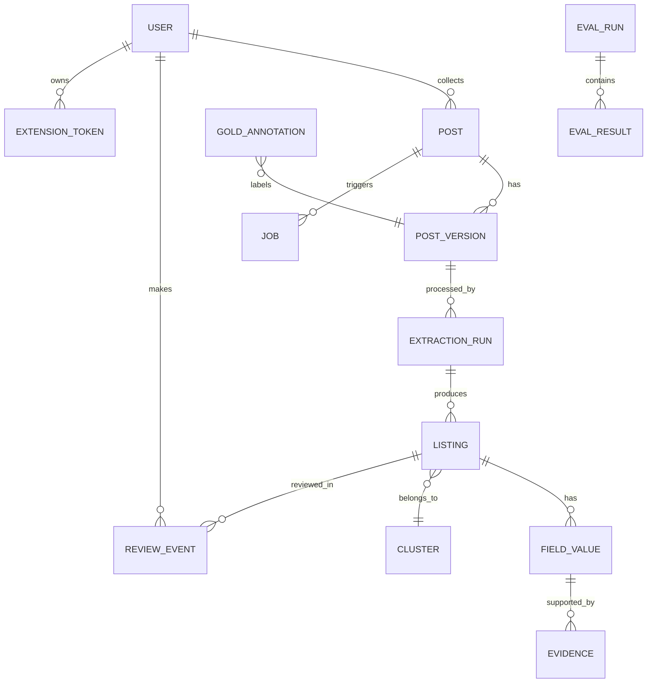

# Cơ sở dữ liệu

SQLite (chế độ WAL) cho demo. Tên bảng và cột tiếng Anh, khớp [từ điển dữ liệu](../02-data/01-tu-dien-du-lieu.md). Kiểu ghi theo SQLite; khi chuyển PostgreSQL thì đổi kiểu tương ứng.

## 1. Sơ đồ quan hệ

## 2. Bảng

### `users`, `extension_tokens`

| Cột | Kiểu | Ghi chú |
|---|---|---|
| `users.id` | TEXT PK | |
| `users.username` | TEXT UNIQUE | |
| `users.password_hash` | TEXT | Không lưu mật khẩu rõ |
| `users.email` | TEXT UNIQUE, nullable | Email chuẩn hóa; tài khoản mật khẩu cũ có thể chưa xác minh email |
| `users.google_subject` | TEXT UNIQUE, nullable | ID ổn định do Google trả qua userinfo; không dùng email để tự gộp tài khoản |
| `users.auth_version` | INTEGER | Tăng khi đặt lại mật khẩu để thu hồi phiên cũ |
| `users.roles` | TEXT (JSON array) | `["collector","reviewer"]` |
| `extension_tokens.token_hash` | TEXT UNIQUE | Chỉ lưu hash |
| `extension_tokens.user_id`, `expires_at`, `revoked_at`, `last_used_at` | | |

Migration `0003` thêm `google_subject` tại chỗ và chỉ mục duy nhất, giữ nguyên mật khẩu,
vai trò và khóa ngoại hiện có. Tài khoản tạo qua Google có `password_hash` rỗng (không có
mật khẩu hợp lệ); chỉ lưu subject và email, không lưu access token/refresh token Google.

### `posts`

| Cột | Kiểu | Ghi chú |
|---|---|---|
| `id` | TEXT PK | ULID |
| `source_type` | TEXT | `facebook_group` / `manual_paste` / `import_file` / `fixture` |
| `source_group_id`, `source_group_name` | TEXT | |
| `permalink` | TEXT | |
| `external_post_id` | TEXT | |
| `collector_id` | TEXT FK users | |
| `mode` | TEXT | `collect` / `assess` |
| `contributed` | INTEGER (0/1) | |
| `is_demo` | INTEGER (0/1) | |
| `post_type` | TEXT | |
| `status` | TEXT | |
| `first_seen_at`, `last_seen_at`, `posted_at` | TEXT (ISO UTC) | |
| `current_version_id` | TEXT FK post_versions | |

Ràng buộc: UNIQUE(`source_type`, `external_post_id`) khi có `external_post_id`.

### `post_versions`

| Cột | Kiểu | Ghi chú |
|---|---|---|
| `id` | TEXT PK | |
| `post_id` | TEXT FK | |
| `text` | TEXT | Đã che SĐT |
| `text_hash` | TEXT | Index |
| `text_complete` | INTEGER | Extension có lấy đủ chữ ("Xem thêm") không |
| `created_at` | TEXT | |

Bài bị sửa trên Facebook → phiên bản mới. Bằng chứng (evidence) luôn trỏ vào một phiên bản cụ thể để bôi màu đúng.

### `idempotency_keys`

| Cột | Ghi chú |
|---|---|
| `key` TEXT, `user_id` TEXT | PK (key, user_id) |
| `request_hash` | Hash nội dung gửi lên, để phát hiện cùng key khác nội dung (409) |
| `result_ref` | post_id hoặc analysis_id |
| `created_at` | Giữ tối thiểu 7 ngày |

### `jobs`

| Cột | Kiểu | Ghi chú |
|---|---|---|
| `id` | TEXT PK | |
| `kind` | TEXT | `extract` / `reprocess` / `recompute_market` |
| `post_version_id` | TEXT FK | |
| `status` | TEXT | `queued` / `running` / `succeeded` / `failed` |
| `attempt` | INTEGER | |
| `run_after` | TEXT | Thời điểm được lấy lại khi thử lại có giãn cách |
| `locked_by`, `locked_until` | TEXT | Worker đang giữ job; hết hạn thì worker khác được lấy |
| `error_code`, `error_message` | TEXT | Không chứa nội dung bài hay khóa API |

Worker lấy job bằng một câu UPDATE có điều kiện (`status = 'queued' AND run_after <= now`), đặt `locked_until`. Ghi kết quả và chuyển `succeeded` trong cùng một transaction. Bước ghi kết quả phải chịu được việc chạy lại (không tạo listing trùng cho cùng run).

### `extraction_runs`

| Cột | Ghi chú |
|---|---|
| `id`, `post_version_id`, `created_at` | |
| `mode` | `production` (tiết kiệm LLM) / `eval_regex` / `eval_llm` / `eval_hybrid` |
| `pipeline_version`, `regex_version`, `prompt_version`, `model_id`, `normalizer_version` | Để tái lập |
| `llm_status` | `ok` / `not_run` / `error` |
| `llm_calls`, `latency_ms`, `tokens_in`, `tokens_out` | Chi phí |

### `listings`

| Cột | Ghi chú |
|---|---|
| `id`, `run_id`, `listing_index` | |
| `cluster_id` | FK clusters |
| `review_status` | `auto_accepted` / `needs_review` / `approved` / `rejected` / `duplicate` |
| `review_reasons` | JSON array: `conflict`, `multi_listing`, `basis_unknown`, `possible_duplicate`, `llm_error` |
| `version` | Tăng mỗi lần người duyệt sửa; dùng chống ghi đè |
| Cột tra cứu nhanh (sao chép từ field_values để lọc): `rent_amount_vnd`, `rent_form`, `rent_basis`, `rent_period`, `area_m2`, `property_type`, `ward_code`, `observed_at` | Index trên (`ward_code`, `property_type`, `rent_basis`, `observed_at`) |

### `field_values`, `evidence`

| Bảng | Cột chính |
|---|---|
| `field_values` | `listing_id`, `field` (`rent`/`area`/`room`/`location`/`fee`), `value_json` (đúng cấu trúc trong schema), `decision`, `abstain_reason`, `agreement`, `source` (`regex`/`llm`/`human`) |
| `evidence` | `field_value_id`, `start`, `end`, `quote`, `label`, `method`, `rule_id` |

### `clusters`, `review_events`

| Bảng | Cột chính |
|---|---|
| `clusters` | `id`, `created_at`, `merge_reason`, `latest_listing_id` |
| `review_events` | `listing_id`, `user_id`, `action`, `before_json`, `after_json`, `reason`, `created_at` — chỉ thêm, không sửa/xóa |

### Đánh giá: `gold_annotations`, `eval_runs`, `eval_results`

| Bảng | Cột chính |
|---|---|
| `gold_annotations` | `post_version_id`, `split` (`pilot`/`dev`/`test`), `cluster_key`, `annotator`, `spans_json`, `listings_json`, `adjudicated` |
| `eval_runs` | `id`, `split`, `methods`, các version như `extraction_runs`, `frozen` (0/1), `created_at` |
| `eval_results` | `eval_run_id`, `method`, `field`, `metric`, `value`, `support` |

Tập chuẩn có thể chỉ nằm trong file `data/gold/` (không vào DB sản phẩm); bảng `gold_annotations` dùng khi muốn trang Lab đọc trực tiếp.

## 3. Lưu giữ và xóa

| Dữ liệu | Giữ bao lâu |
|---|---|
| Bài nhận định không đóng góp | 7 ngày rồi xóa nội dung |
| Bài thu thập / đóng góp | Hết đồ án; xóa khi kết thúc môn hoặc khi có yêu cầu gỡ |
| Tập chuẩn đã ẩn danh | Giữ cùng báo cáo đồ án |
| Nhật ký duyệt | Giữ cùng dữ liệu liên quan |

Yêu cầu gỡ một bài: xóa post, các phiên bản, listing và evidence liên quan; tính lại thống kê nhóm bị ảnh hưởng.
